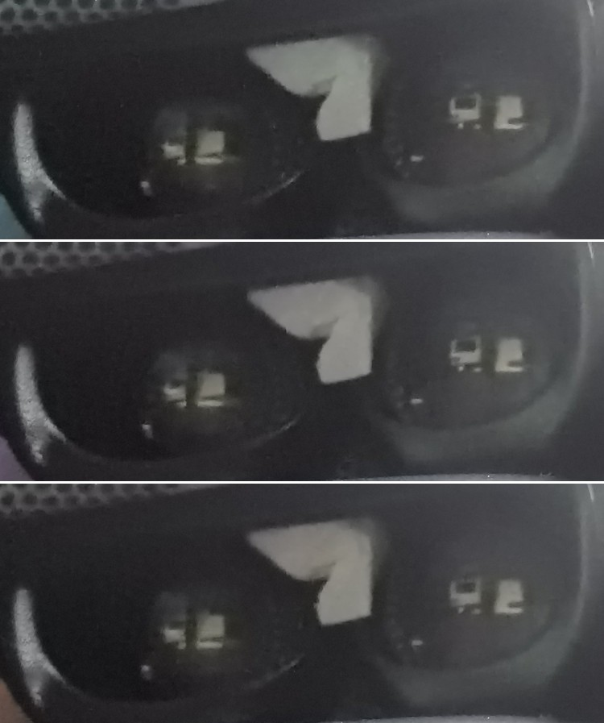
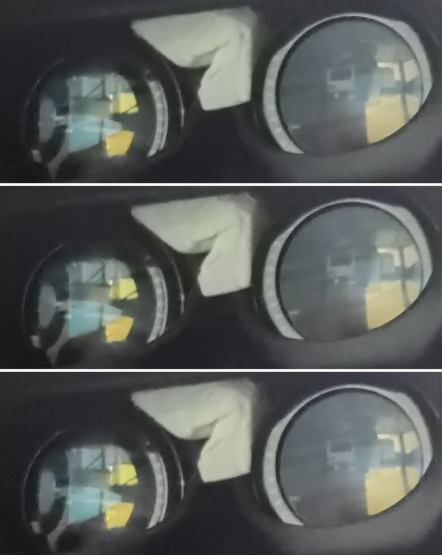

# CV10 原厂手机线黑屏排查 · 2026 年 11 月 25 日晚至 26 日上午

**本次未用原厂手机线点亮 CV10。** 同一副眼镜用 Gen 2 C-C 线直连 P40 Pro+ 可以看见华为 VR 桌面，直连 Fold7 可以看见左蓝 L、右橙 R。换上带供电口的原厂线后，两部手机都识别了外屏，佩戴者看到的仍是双眼全黑。26 日上午修复了这台电脑的头显控制驱动，眼镜首次向电脑明确回复开屏成功。随后让眼镜对应的输出在整屏洋红和整屏绿色之间切换，P40 实拍的双眼均未随之变色。

这根线已经刷回本线备份的 **C9.49.6**。目前有两个可复现的问题。手机端，原厂线下游 USB 集线器会重枚举，眼镜音频和控制接口随之消失。电脑端，Windows 读到了眼镜声明的原生分辨率，但 AMD 核显只向桌面开放了 **640×480**。两个问题需要分别验证。盒内电量计的无效读数仍无法确定电芯健康状况。

## 同一副眼镜的四组对照

| 主机及接线 | 主机端实测 | 镜片验收 |
| --- | --- | --- |
| P40 Pro+，Gen 2 C-C 直连 | 华为 VR 服务启动，3200×1600、70 Hz，控制和音频保持在线 | 佩戴者确认双眼显示华为 VR 桌面 |
| P40 Pro+，原厂线及外接 5 V | 华为仍启动 VR 服务，3200×1600、70 Hz。一轮控制接口接入 0.865 秒后掉线 | 双眼持续黑屏 |
| Galaxy Z Fold7，Gen 2 C-C 直连 | 3200×1600、90 Hz。亮度从 4 调到 1 并读回，之后恢复为 4 | 两档都能看见左右眼图案 |
| Fold7，原厂线及外接 5 V | 两版线控固件都收到过头显开屏应答。C9.49.6 有一轮先提交左右眼图案，1.322 秒后收到开屏 `OK`，再过 1.150 秒控制接口掉线 | 双眼持续黑屏 |

手机端试过给转接盒预充半小时、更换固定 5 V 电源和供电线、拔掉辅助电源、改变两端插入顺序及翻转插头。个别接法能延长控制接口在线时间，预充后一轮超过一分钟，仍未出现画面。拔电后 P40 曾以供电主机身份维持头显控制约 88 秒，当时系统只有内屏。Fold7 暂设 80% 充电上限后，已核实手机电池在掉线前停止充电，原厂线仍黑。测试后恢复三星原有的「基本」充电保护和头显亮度。[P40 供电和枚举时间线](../research/evidence/p40-original-c9526-power-roles.txt) · [两版固件与低亮度对照](../research/evidence/fold7-original-firmware-retest-20261126.txt)

P40 先在手机本地记录直连与原厂线的切换，随后通过无线 ADB 同时采集 USB 角色、外屏和原厂服务日志。两种接法都启动了华为 VR 服务。即使给诊断应用授予 USB 权限，P40 的系统串口驱动仍占用头显专用接口，后续读数改在 Fold7 上对照。25 日 22:14 和 22:18，Fold7 上原厂线和正常直连各自查询左右 LCD，两种接法均返回 `READ LCD timeout!`。因此不能用这条查询判断面板是否点亮。[P40 首次成对记录](../research/evidence/p40-direct-original-usb-vr-20261126.txt) · [左右 LCD 查询与电脑实测摘要](../research/evidence/pc-original-cable-20261126.json)

## 电脑实测与镜片记录

电脑通过已经用普通显示器验证过视频输出的主板 USB-C 口连接原厂线。原厂线另一端接 CV10，转接盒接 5 V / 2 A 电源。主显示器由 RTX 3090 驱动，眼镜物理连接在 AMD Radeon 核显上。P40 Pro+ 单独用 USB 接电脑，后置主摄固定对准两枚镜片。以下时间均为香港时间。

| 时间 | 操作 | 结果 |
| --- | --- | --- |
| 25 日晚 | 普通显示器经 C 转 DP 接同一个主板 C 口，重新插紧后复测。另用 C-C 直连眼镜、运行 NOLO HOME 和 SteamVR | 普通显示器可亮。这次眼镜在 PC 直连时也黑屏。23:59 SteamVR 合成器报告 `Invalid adapter output specified! (-1) 887A0002`，对应错误 422。此前项目另有 Windows 直连可见的用户记录，未记录当时使用的显卡输出和时序 |
| 26 日 02:27 起 | 电脑端和 5 V 固定，将眼镜接回原厂线。只给这副眼镜的 USB 复合父设备换用微软内置驱动 | 线控的 Billboard 接口随接线状态消失，Windows 将 HUAWEIAV03 列为活动扩展屏。眼镜的音频和两个 HID 出现，父设备的代码 39 已解除 |
| 02:46 | 仅在眼镜对应的扩展屏绘制 L／R 图案，并发送华为 PC 端使用的 HID 来源选择命令 | Windows 窗口覆盖该屏的 640×480 桌面。佩戴者确认全黑，P40 照片中也没有蓝、橙图案 |
| 02:46–03:03 | 通过 GDI、Windows 显示配置 API 和 AMD 显示库请求 EDID 中的 70 和 90 Hz 原生时序 | 驱动拒绝两组 3200×1600 时序。DXGI 只列出一档 640×480。AMD 自定义时序接口返回 `-1`，驱动中未出现新模式 |
| 03:03–03:08 | 在这副眼镜的专用控制子接口 MI_00 上试华为签名的 PCUI 驱动。同时短时修正本机 EDID 水平扫描上限，重新枚举眼镜显示器和驱动它的 AMD 核显 | MI_00 此前报告代码 28，绑定华为 `hwusb_cdcacm` 后报告代码 39，未能选中微软 WinUSB 候选。修改 EDID 后仍只有 640×480，03:04 镜片实拍仍黑。03:07:44 删除覆盖，03:08:01 完成核显重新枚举 |
| 03:05 | 用头显 HID 启用佩戴感应和 IMU，再拍同一测试图 | Windows 接受这些 HID 请求。两枚镜片仍只有环境反光。此次 PC 端没有取得面板开屏 AT 应答 |
| 03:06–03:08 | 在隔离的 OpenVR 配置中按实测显示位置、显卡索引和产品号启动 NOLO 驱动 | 初次进入驱动初始化，vrstartup 随后报 301，重启的服务器因之前的安全模式事件跳过该驱动。未取得合成器成功出图记录。用户原有设置和 OpenVR 路径文件的摘要复核一致 |
| 约 03:09 起 | Computer Use 收到实体 Esc 停止信号，结束桌面交互。此前启动的记录程序继续读取显示时序和设备枚举 | 当时 Windows 使用原始 EDID 和微软复合父设备驱动，华为 MI_00 仍报代码 39 |
| 03:09–09:13 | 保留现有采样，期间没有主动下发新的开屏或显示试验 | 用户于上午说明自己没有按 Esc。Windows 远程桌面的 LocalSessionManager 和 RdpCoreTS 两份日志均已启用，在 03:03–03:14、09:09–09:20 两段都没有事件。Esc 的输入来源仍无法确认 |
| 09:13–09:19 | 恢复独立 USB 和相机测试。09:18:50 仅为眼镜 MI_00 绑定微软 WinUSB，随后读型号、确认 PC 来源并发送开屏命令 | 代码 39 清除，无需重启。CV10 回复 `^SWITCHSCREEN=1` 和 `OK`，异常查询为 0。09:19:41 镜片实拍依然看不到 L／R |
| 09:20–09:21 | 先向眼镜对应的显示器读取和设置 DDC/CI 电源功能，再在该屏依次铺满洋红和绿色，分别用支架上的 P40 拍照 | DDC/CI 三次操作均返回 Windows 错误 31。两张照片里反光的位置和颜色基本相同，两枚镜片均未出现所送色块 |
| 09:24 | 开屏应答成功后，再用 Windows 显示配置 API 请求 3200×1600，并允许驱动自行选取兼容时序 | 指定 70 或 90 Hz 的自动选时序请求均返回 87。允许任意刷新率时应用返回成功，立即回读的桌面和活动信号却仍是 640×480。主显示器保持 2560×1440 |
| 09:27 | 在电脑端逐眼查询 LCD，每次等头显答复后才查另一眼 | 两次约 3.01 秒后都收到 `READ LCD timeout!`，随后异常查询仍为 0。能显示的 Fold7 直连此前也得到相同的 LCD 超时 |

下图由三张 P40 原照的同一区域裁切而成，依次为 02:46 的基线、03:04 的 EDID 试验和 03:05 的佩戴感应试验。画面中央的浅色小矩形是三次照片里都可见的反光。眼镜端应出现的蓝色 L 和橙色 R 在三张照片里均不可辨认。原照的 SHA-256 保存在读数文件中。[电脑读数与原照摘要](../research/evidence/pc-original-cable-20261126.json)

下图三行使用相同的裁切范围，依次对应开屏应答后的左右眼字符图、整屏洋红、整屏绿色。日光下反光很亮，判读依据是两眼均未呈现指定图案，也没有随大面积换色改变。六张原始照片的摘要和两个拼图的摘要均可在记录中核对。[照片及对应测试](../research/evidence/pc-original-cable-20261126.json)

<!-- observation-start -->
本次观察于 11 月 26 日 09:30 截止。只读观察从 02:51:47 到 09:29:41，共 434 次，最长采样间隔 56 秒。每次采样的副屏信号均为 640×480。两个头显 HID 在 434 次采样中同时可枚举。最后一张镜片照片拍于 09:21。常规采样只记录电脑端信号和设备状态。
<!-- observation-end -->

## EDID、显示链路与 SteamVR 422

- **三种接法读到相同的 EDID。** 本轮 Windows 原厂线、Fold7 原厂线和 Fold7 直连的 EDID 各为 256 字节，SHA-256 均为 `55f1e31462b6905922e91b7fa3732f84367175c3319a692a06529e7d23a629fb`。两个 128 字节块各自校验通过，名称为 HUAWEIAV03，Windows 设备标识为 HWV0003。项目早期另有一份以 `326e58b2` 开头的 Windows 注册表缓存，含 1080p 详细时序。此次从 AMD 接口和 Fold7 内核取得的扩展块均无这条时序。[本轮 EDID 与链路读数](../research/evidence/pc-original-cable-20261126.json) · [早期 Windows 缓存记录](device-openxr-check.md)
- **EDID 声明有一处矛盾。** 两个详细时序都是 3200×1600，像素时钟分别为 529.94 和 412.18 MHz，总宽均为 3308 像素，水平扫描率约 160.20 和 124.60 kHz。范围描述符却写成 15–68 kHz。本机试验只把上限改为 161 kHz，并更新该块校验字节。复测时桌面与实际选定的信号仍是 640×480、59.94 Hz、25.175 MHz。单改这一字段未能开放原生模式。覆盖只作用于 Windows 中这一台显示器，已回滚。[微软的逐块 EDID 覆盖说明](https://learn.microsoft.com/en-us/windows-hardware/drivers/display/overriding-monitor-edids)
- **两台主机的协商结果不同。** Fold7 使用两种线时均记录到 DP 引脚配置 C、HBR2 四通道、两阶段训练成功和视频流启用。两种线都出现过 HDCP 2.2 认证失败，工作正常的直连仍可显示测试图。Windows 的 AMD 接口曾报告 RBR 一条活动通道、四条总通道，也返回过未知速率及零活动通道。该读数对应当时的低分辨率模式，尚未确定是带宽受限导致回退，还是驱动随已选模式降低了链路速率。[Fold7 内核对照](../research/evidence/fold7-original-vs-direct-dp.txt) · [AMD 显示库](https://github.com/GPUOpen-LibrariesAndSDKs/display-library/tree/84c881cb2136f04287eb3af12de00a9e2867aa9e) · [VESA 链路速率资料](https://www.vesa.org/wp-content/uploads/2017/06/VESA-DP-Tech-Update-62117.pdf)
- **422 出现在合成器选择桌面输出时。** 23:54:00 `vrserver` 已加载 NOLO 的 `huaweicv1pro`，并将它设为活动头显。23:54:03 至 23:59:49，合成器多次判断头显在桌面上，接着报告输出索引 `-1`，最后一行是 `VRInitError_Compositor_InvalidOutputDesktop`。实测 AMD 是 DXGI 适配器 1、输出 0。NOLO 的默认设置含产品号 2，本机眼镜为 3。同版本驱动 DLL 有按 `HWV0003` 搜索实际 DXGI 输出的路径，不能单凭默认产品号解释 422。它还读取 `lowVersionDriver` 来选择查找输出的分支，出错现场该标志的取值未记录。[Valve OpenVR 驱动接口](https://github.com/ValveSoftware/openvr/blob/master/headers/openvr_driver.h)
- **群资料和官方适配的范围不同。** 本地群文件问答收录了 NOLO 与华为助手外部驱动登记冲突，没有检索到字面错误码 422。随附 6DoF 说明的成功条件包含眼镜可选 3200×1600 扩展屏，不能据此认定本机已经满足条件。华为支持文档要求眼镜接 NVIDIA 独显，并列出 Belkin、FIBBR 计算机线。此次主板 AMD 核显和带供电口的原厂手机线属于另一种接法。[群文件问答](../docs/reference/华为vr%20glass问题汇总与解答.xlsx) · [群文件有线连接说明](../docs/reference/华为vr%20glass%206dof%20PC有线连接说明v0.1.docx) · [华为电脑黑屏排查](https://consumer.huawei.com/cn/support/content/zh-cn00793812/)

### 凌晨的控制驱动加载失败与上午的开屏应答

Windows 安装日志记录，03:03:21 头显 MI_00 已匹配华为 PCUI 驱动 `1.0.26.0`，内核加载阶段返回 `0xC000007B`（`STATUS_INVALID_IMAGE_FORMAT`），设备管理器随之报告代码 39。驱动文件实际存在，是 x64 程序，和驱动仓库副本的 SHA-256 相同。USB 父设备和两个 HID 当时可以工作，失败的环节已缩小到专用控制子接口的驱动加载。[微软的代码 39 说明](https://learn.microsoft.com/en-us/windows-hardware/drivers/install/cm-prob-driver-failed-load) · [NTSTATUS 对照](https://learn.microsoft.com/en-us/openspecs/windows_protocols/ms-erref/596a1078-e883-4972-9bbc-49e60bebca55)

旧驱动的 PE 节对齐值为 `0x80`，`INIT` 节同时可写、可执行。这两项不满足微软对内存完整性兼容驱动的要求。现有日志足以确认映像加载失败，仍不能把本机这次拒载单独归因于内存完整性。[驱动摘要与读数](../research/evidence/pc-original-cable-20261126.json) · [微软的驱动兼容条件](https://learn.microsoft.com/en-us/windows-hardware/drivers/driversecurity/implement-hvci-compatible-code)

上午改用设备实例和父设备定位这副眼镜的 MI_00，从微软随系统提供的 `winusb.inf` 选择 `WINUSB` 型号。绑定后设备问题码为 0。控制端依次读回型号 CV10、头显固件 CV10AC10.0.1.357、来源 PC（1）、Type-C 状态 1、线控信息 `10C094906255+280`。随后头显对 `AT^SWITCHSCREEN=1` 明确应答成功。驱动保持在这次实测可用的状态。电脑的视频输出仍维持 640×480，尚未验证眼镜在此接法下接收原生时序时的表现。[上午的控制与时序读数](../research/evidence/pc-original-cable-20261126.json)

复现控制通道时，先为指定的 `winusb.inf` 建立型号列表，再由 `SetupDiOpenDeviceInfoW` 使用 `DIOD_INHERIT_CLASSDRVS` 将列表带到已核对的头显子设备。实际接口的类、子类和协议为 `FF/13/12`，批量写端点为 `0x01`，读端点为 `0x81`。向写端点发以 CRLF 结尾的 `AT^DEVMODEL?` 并读回型号，就能在发开屏命令前验证设备身份。另两条运行模式和佩戴状态查询均回复 `NO PERMISSION`。[控制接口与应答记录](../research/evidence/pc-original-cable-20261126.json)

项目已有一次可见光对照与本机症状吻合。Fold7 用好线进入 DeX 扩展模式时，活动信号也是 640×480，开屏回复成功，镜片仍黑。保持这根线切到「已镜像」后，活动信号变为 3200×1600，重新绘图并开屏后拍到了图案。因此电脑端值得先验证原生信号。手机使用原厂线时已有原生模式仍然黑屏，还需单独解释原厂线带来的差异。[Fold7 同线切换前后的镜片记录](usb-panel-research.md)

## 线内电池与固件

| 可复查的读数或操作 | 对黑屏的解释 |
| --- | --- |
| 25 日晚试写群友 C9.52.6，并做过 C9.49.6 回读。26 日 00:59 P40 读到 C9.52.6，电脑随后双读也为 C9.52.6 | 两个时间点之间版本为何变化仍未知。用于最终复测的版本以新的断电后双读为准 |
| 26 日 01:41 起回刷本线 C9.49.6 的 12 个差异扇区。回刷后以及 Fold7 复测并断电后均重新双读，49,152 字节与原备份一致 | 本线原版 SHA-256 为 `f16057065c4c29d6d86901239371f2a6aab2bcf03c6976505c8f5971fba93e02`。群友版为 `1ebf1217d0dda526f64ed3b15504db409fbdf25bc866f0fbebb874adcd00485a`。两版均复现黑屏，售后成功案例仅有口述 |
| 在 Fold7 上，头显经原厂线返回 `AT^CABLEINFO?` 为 `10C094906255+280`、`AT^TYPECSTATE?` 为 2，直连分别为 16 个零和 1。上午的 PC 原厂线读到相同的线控字符串，Type-C 状态为 1 | 两种手机接法的线控字符串有差异，单看 Type-C 状态无法跨主机辨认线缆。升级包内的 halliday.dfu 与头显实测版本 CV10AC10.0.1.357 对应 |
| 固件访问盒内 I²C 地址 `0x55`，从 `0x2C` 读电量相关字节，从 `0x66/0x67` 读温度原值。线单接电脑时 35 次读到 `FF / FFFF`，加辅助 5 V 后 96 次读数相同，另一状态字节确实从 `81` 变为 `83` | 255 超出有效百分比。头显对 `FFFF` 的字符串格式化也能生成 `+280`，无法据此确认 28.0 °C。接入头显后线控 Billboard 接口退出，未能用同一读法测带载电量 |
| P40 上的电池查询在原厂线和可以点亮的直连下都出现 `Broken pipe`。Fold7 的头显异常查询两种线都返回 0，MCU 日志请求也返回相同的权限应答 | 这三项查询没有区分故障。现有证据支持继续查盒内供电、电量计通信及集线器复位，缺少电芯电压和带载电流，无法判定电芯损坏，也没有证据证明固件可实现纯外部供电 |

在 Windows 以「连接手机」一端单独接入这根线，可运行 `python tools/cable.py battery` 读取线控缓存。此次 C9.49.6 的输出为 `level_raw=255`、`temperature_raw=65535`、`temperature_c=null`。[工具和接法](cable.md) · [逐项固件与采样证据](../research/evidence/fold7-original-firmware-retest-20261126.txt) · [USB 集线器掉线顺序](../research/evidence/fold7-original-hub-reenumeration.txt)

在本线固件已定位的电量比较处，`FF` 会走数值大于 60 的分支。相邻的温度检查遇到 `FFFF` 会跳过。现有软件读数因此不能证明线控因「电量为零」主动关机。电芯在带载时电压下跌或板上另一处触发保护，仍需带载测量才能区分。[固件偏移与阈值](../research/evidence/fold7-original-firmware-retest-20261126.txt)

## 交接

点亮的验收标准是两枚镜片分别出现 L 和 R，并能实拍留存。下一次最能缩小范围的对照，是在能向这副眼镜实际输出 3200×1600 的 PC 视频口先用已知好线点亮，再仅换原厂线。可优先使用华为列出的独显接法。两次都记录活动信号、头显开屏应答和镜片照片，这能判断原厂线在相同原生时序下能否出图。Windows 上 P40 与头显可能使用相同的 VID／PID，定位驱动时应核对接口号和父设备。手机端可随时用已验证的 Gen 2 C-C 恢复显示。

实机数据和线控读取工具在提交 `ecdeab4`，与 GitHub 协作分支当时最新提交 `775eab8` 的合并点为 `330aceb`。远端引入的 Monado CV10 和 PiliPlus 子模块均按其固定提交检出。现有主项目发行标签 `v0.1.1` 对应 `8ecdb63`。[协作分支](https://github.com/RayforLoy/HUAWEI_CV10_EVO/tree/codex/cv10-phase1)
