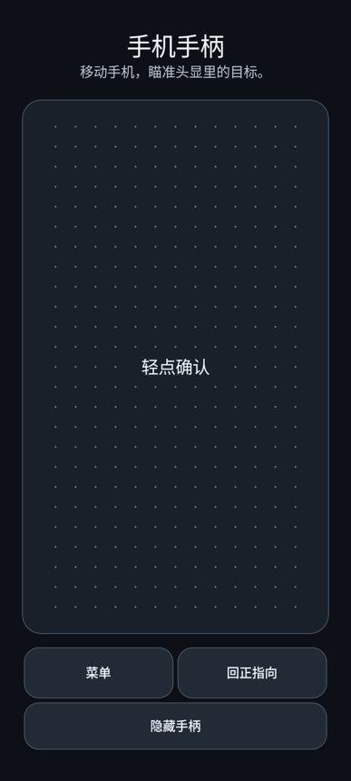

# Fold7 的手机手柄与 CF20

连接 CV10 后，在 OpenXR Broker 选择 **Monado CV10**。从手机桌面打开第三方 OpenXR 应用即可进入手柄模式。竖持 Fold7 时，主屏显示 Monado 的点阵触摸板、菜单、回正指向和隐藏控件，应用画面送到眼镜。Monado 在 XR 会话开始且应用窗口获得焦点后挂载面板，在会话结束或窗口失焦时释放输入。Android 权限框和系统导航仍可操作。横屏应用保留自己的 Activity 配置，运行时单独旋转手柄界面，使竖持手机时文字正读。

在 Monado 首页打开 **应用启动器 → 手机操控 OpenXR 应用** 配置。默认开启手机手柄。

| 模式 | OpenXR 左手 | OpenXR 右手 |
| --- | --- | --- |
| 默认，只有手机 | 空 | 手机 |
| 默认，两只手柄在线 | 手机 | CF20 |
| 左右互换，两只手柄在线 | CF20 | 手机 |
| 仅手机 | 空 | 手机 |

手机与 CF20 各有自己的握持和瞄准位姿。手机可提供 Daydream 触摸板配置，也兼容 `/interaction_profiles/khr/simple_controller` 的确认和菜单。应用可为两只手分别创建动作空间，使用 `xrSyncActions` 和 `xrLocateSpace` 区分输入来源。设备提供旋转追踪，手部位置由运行时估算。

## 第三方应用接口

| 来源 | 接口 | 实现 |
| --- | --- | --- |
| 手机触摸板 | `/interaction_profiles/google/daydream_controller` | `/input/trackpad` 提供归一化二维位置，右、上为正。`/input/trackpad/touch` 表示接触；轻点抬手触发 `/input/trackpad/click` 和 `/input/select/click`。滑动、长按和取消不会生成点击 |
| CF20 按键和触控板 | `XR_HUAWEI_controller_interaction`，`/interaction_profiles/huawei/controller` | Home、返回、音量加减、扳机和触控板按压分别绑定；触摸状态、二维触点与按压独立。向右为 +X，向上为 +Y。扳机同时提供 click 和 0/1 的 value |
| 旧应用 | `/interaction_profiles/khr/simple_controller` | 扳机或触控板按压映射为 select，返回映射为 menu。长按实体 Home 约一秒，由运行时回正 |
| CF20 电量 | `XR_EXT_interaction_profile_battery_state_display` | 在相应手的 `xrGetCurrentInteractionProfile` 上串接 `XrBatteryStateDisplayEXT`。仅在 `VALID` 时读取 0–1 的 `batteryLevel`。未连接、过期或手机手柄不会复制 CF20 的电量。电池充电状态无可靠观测值 |
| CF20 角速度 | `xrLocateSpace` 的 `XrSpaceVelocity` | 用连续有效的 CF20 姿态和单调时间计算，以参考空间的 rad/s 输出。回正或重连时重置历史。应用应检查角速度有效位。华为报告中的三个原始陀螺仪字段可另作诊断 |
| CV10 佩戴 | `XR_EXT_user_presence` | `xrGetSystemProperties` 返回 `supportsUserPresence=XR_TRUE`。进入运行态后通过 `xrPollEvent` 读取初始状态，其后摘下和戴上各产生一次 `XrEventDataUserPresenceChangedEXT` |

实体手柄电量的有效位和查询方法见 [Khronos 的电量接口](https://registry.khronos.org/OpenXR/specs/1.1/man/html/XrBatteryStateDisplayEXT.html)。会话初始佩戴事件见 [Khronos 的佩戴检测接口](https://registry.khronos.org/OpenXR/specs/1.1/man/html/XrEventDataUserPresenceChangedEXT.html)。

## 模型与验收

手机的手柄输入与手机外形是两项独立的 OpenXR 功能。应用可以只用握持或瞄准动作，也可以枚举 `XR_EXT_interaction_render_model` 提供的模型，并按各自的 subaction path 和模型空间绘制。物理 CF20 的原厂外观可由用户在 Monado 首页的「更多选项 → 导入已校准的 CF20 手柄模型」导入。详见[模型提取和坐标约定](../controller/cf20-openxr-model.md)。

PiliPlus 的双手版本从运行时读取两个独立的 GLB。手机有自己的握持空间，屏幕法线对应设备正面，顶边对应手机顶部。手机旋转向量决定机身的俯仰、偏航和滚转，瞄准仍沿用平放和竖持各自的校准。与 CF20 一样，运行时按头部与手柄姿态估算腕部位置，射线和模型共享腕部原点。仅把实体手机平移且保持朝向不变时，3DoF 硬件无法测出这段位移。

默认两只手均在线时，PiliPlus 显示左侧的手机和右侧的 CF20。按对应手的确认键即可切换主射线，当前拖动会保持到松手。[配套 PiliPlus](https://github.com/RayforLoy/piliplus_monado/releases/tag/cv10-dual-controller-zoom-20261128) · [Monado CV10 安装包](https://github.com/RayforLoy/Monado_CV10/releases/tag/v0.1.4-rc.4)

### Fold7 实测

2026-11-28，原厂线配外部 5 V / 2 A，线盒自报字段为 `0C095306`。正式上传的 rc.3 APK 与 Fold7 安装文件逐字节一致。PiliPlus 的两个模型均可辨认、能分别确认点击。佩戴者复测了实体 Home 回正和手机竖屏文字方向，随后在修正机身坐标和腕位的构建中确认平放、竖持及摆腕表现正常。

| 实测项目 | 应用所见 |
| --- | --- |
| 标准输入 | 六个实体按键均出现按下、松开。向上滑时 Y 从 0.027 增至 0.569，向右滑时 X 从 −1.000 增至 0.867。手柄转动时获得有效三轴角速度 |
| 电量与佩戴 | CF20 报告 96–97%。移开遮挡、重新遮住后，独立客户端分别在 USB 状态变化后 8 ms、5 ms 收到佩戴事件 |
| 默认及互换 | rc.3 在同一帧枚举两个不同模型。默认左手为 20,908 字节的手机，右手为 182,180 字节的 CF20。交换后两条路径互换，电量有效位随 CF20 到左手 |
| 握持方向与移动 | 手机平放时，独立 Android 传感器测得屏幕法线向上分量约 0.998，模型约 0.998。机身可保留滚转，手机和射线使用同一估算腕位 |

附件的 SHA-256、原始事件节选和各轮使用的 APK 见[分版本实测记录](../research/evidence/fold7-dual-controllers-20261128.json)。rc.3 也在原版 `hello_xr` 的 NativeActivity 内显示了手机控制面板。

### rc.4 的手机触摸板

手机可轻点触摸板，在抬手时确认一次。超过系统长按时限、滑动超出 Android 的触摸容差或手势被取消时只传递触点。支持 Daydream 配置的应用可读取连续 XY。PiliPlus 绑定 simple controller，可用确认和菜单，翻页时瞄准选片面板的翻页按钮。手机手柄显示时窗口亮度为 10%，隐藏后恢复应用最近请求的亮度，日常自适应亮度继续由系统管理。

Fold7 已安装 rc.4，本轮独立 OpenXR 客户端冷启动进入 FOCUSED。Android 16 模拟器使用发布包的原始 DEX 和界面资源，在两个独立进程间通过 Binder 验证了触摸、确认和亮度恢复。家中复测的接线、安装包与步骤见[本轮交接](fold7-home-handoff-20261128.md)。
